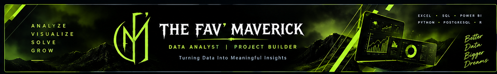

<h3 align="center">ASPIRING DATA ANALYST | EXCEL • SQL • POWER BI</h3>

  <a href="https://ambi-rajan-portfolio.vercel.app">PORTFOLIO</a> •
  <a href="https://linkedin.com/in/ambi-rajan005">LINKEDIN</a> •
  <a href="https://github.com/thefavmaverick-coder">GITHUB</a>

---

## 👋 About Me

I'm a Biotechnology graduate building my career in Data Analytics, with an interest in technology, business intelligence, and data-driven problem-solving.

I work on practical projects to explore datasets, identify trends, and turn raw data into meaningful insights.

- 📊 Building Excel reports and interactive dashboards
- 🗄️ Practicing SQL and PostgreSQL for data analysis
- 📈 Developing Power BI dashboards and DAX measures
- 🐍 Learning and improving my Python and R programming skills
- 🤖 Exploring AI-assisted development and NLP-to-SQL
- 🌐 Building a professional portfolio of real projects

## 🛠️ Tech Stack

  
  
  
  
  
  
  
  
  
  

## 🚀 Featured Projects

### 📊 Swiggy Food Sales & Performance Analysis
**Tools:** Microsoft Excel

Analyzed a large food delivery dataset to explore sales performance, category contribution, and geographic trends through interactive dashboards.

[View Repository](https://github.com/thefavmaverick-coder/swiggy-food-sales-analysis)

### 📈 HR Employee Attrition Analysis
**Tools:** Power BI, DAX

Built an HR analytics dashboard to examine employee attrition, workforce metrics, and trends using interactive visuals and DAX measures.

### 🗄️ Retail Sales Analysis
**Tools:** SQL, PostgreSQL

Explored retail transactions using SQL queries to investigate sales performance, customer behavior, product categories, and business trends.

### 🤖 NLP-to-SQL
**Tools:** Python, SQL, LLMs

Explored a workflow for translating natural-language questions into SQL queries using schema context, prompt engineering, validation, and error correction.

### 🌐 Personal Portfolio Website
**Tools:** HTML, CSS, JavaScript

Developed an AI-assisted personal portfolio website to showcase projects, skills, certificates, and professional links.

---

## 📊 GitHub Statistics

  

  

## 🤝 Connect With Me

  
  
  

---

  <b>LEARN • BUILD • ANALYZE • GROW</b>

